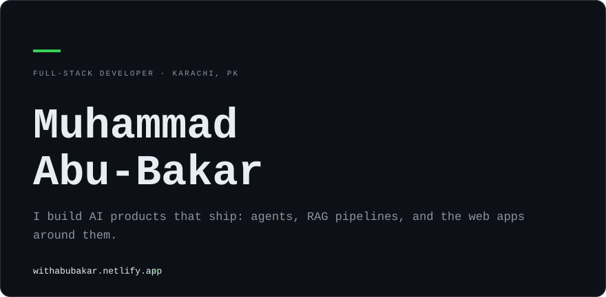
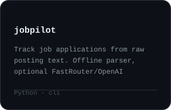
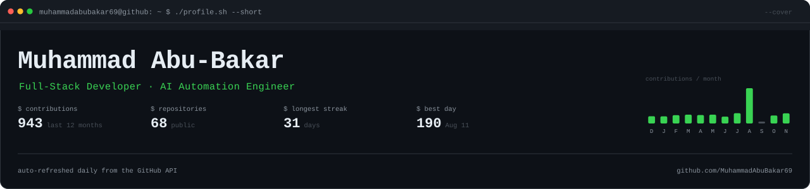
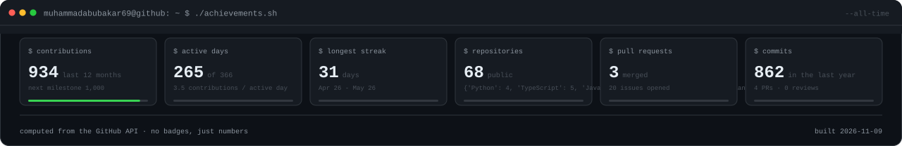
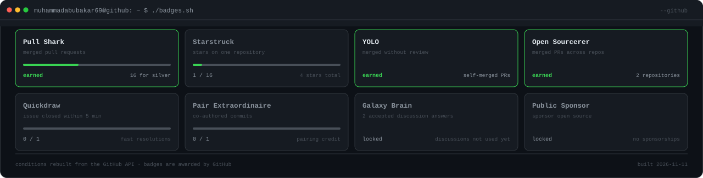
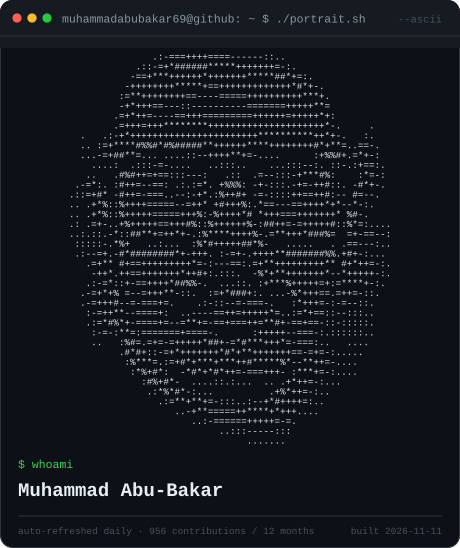
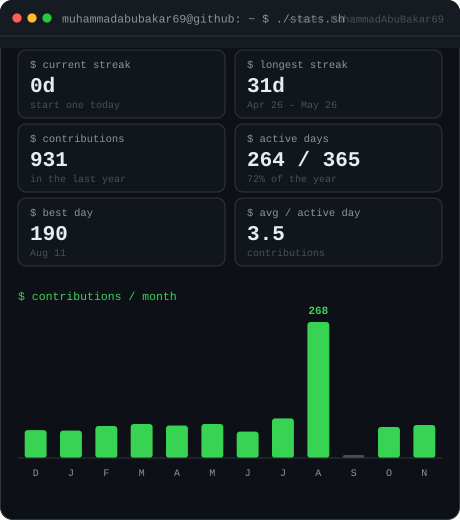

<!-- Card set mirrors the reference profile: hero, contribution graph, activity, three world tiles,
     section rule, three repo cards. Images sit on one line with no whitespace between them, or
     GitHub leaves gaps between the thirds. Rebuilt daily by update-profile-art.yml, never by hand.
     The older terminal panels are kept below in this comment so nothing is lost. -->

 
 
 
 
<picture><source media="(prefers-color-scheme: dark)" srcset="./assets/cards/title-building-dark.svg" /></picture> 

<!--
Kept, not shown: the terminal-era panels. Uncomment to bring any of them back.

-->

<a href="https://muhammadabubakar69.github.io/ask-abubakar/">ask about me</a> &nbsp;/&nbsp; <a href="https://withabubakar.netlify.app">portfolio</a> &nbsp;/&nbsp; <a href="https://www.linkedin.com/in/mohamad-abubakar/">linkedin</a> &nbsp;/&nbsp; <a href="https://github.com/MuhammadAbuBakar69">github</a> &nbsp;/&nbsp; <a href="mailto:md.bakar2006@gmail.com">email</a>

<h3><code>muhammadabubakar69@github ~ $ ./stack.sh</code></h3>

**Frontend**
            

**Backend & Data**
       

**AI / Automation**
   

**Tools & Platforms**
        

 

<h3><code>muhammadabubakar69@github ~ $ ./featured.sh</code></h3>

<!-- featured:start -->

| Project | What it does | Stack | Stars |
| :--- | :--- | :--- | ---: |
| **[Resumind](https://github.com/MuhammadAbuBakar69/Resumind)** | ATS Checker | JavaScript | 1 |
| **[booking-system](https://github.com/MuhammadAbuBakar69/booking-system)** | Booking system with calendar and availability | JavaScript | 1 |
| **[github-analyzer](https://github.com/MuhammadAbuBakar69/github-analyzer)** | GitHub profile analyzer with stats via GitHub API | JavaScript | 1 |
| **[Festivity](https://github.com/MuhammadAbuBakar69/Festivity)** | Awwward Winning Website | CSS | 1 |
| **[MuhammadAbuBakar69](https://github.com/MuhammadAbuBakar69/MuhammadAbuBakar69)** | Auto-refreshing profile art: SVG cards, a halftone portrait and a contribution heatmap... | Python | 0 |
| **[ask-abubakar](https://github.com/MuhammadAbuBakar69/ask-abubakar)** | Ask about Muhammad Abu-Bakar and his repositories. Answers are retrieved from public re... | JavaScript | 0 |

<!-- featured:end -->

 

<h3><code>muhammadabubakar69@github ~ $ ./snake.sh</code></h3>

<picture>
  <source media="(prefers-color-scheme: dark)" srcset="https://raw.githubusercontent.com/MuhammadAbuBakar69/MuhammadAbuBakar69/output/github-contribution-grid-snake-dark.svg">
  <source media="(prefers-color-scheme: light)" srcset="https://raw.githubusercontent.com/MuhammadAbuBakar69/MuhammadAbuBakar69/output/github-contribution-grid-snake.svg">
  
</picture>

 
 

<h3><code>muhammadabubakar69@github ~ $ ./links.sh</code></h3>

 

<i>This README maintains itself. The cover, achievements, graph, streaks and language stats are
pulled from the GitHub API every morning, so the numbers are always current. Nothing on this page is
a hand-typed claim: if a figure stops being true, it changes on its own.</i>

